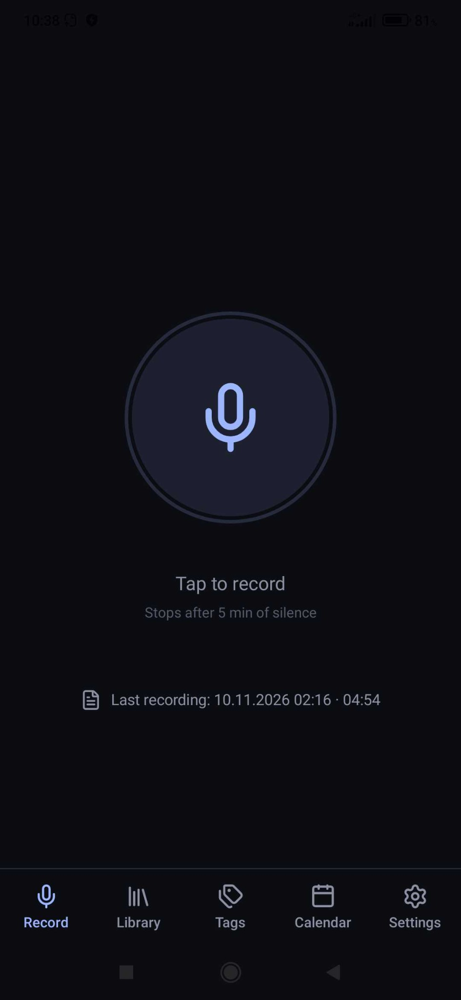
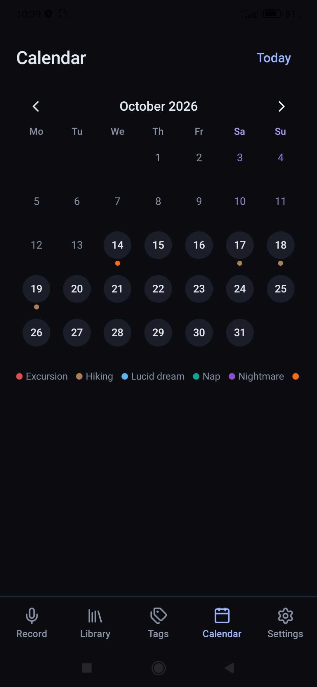
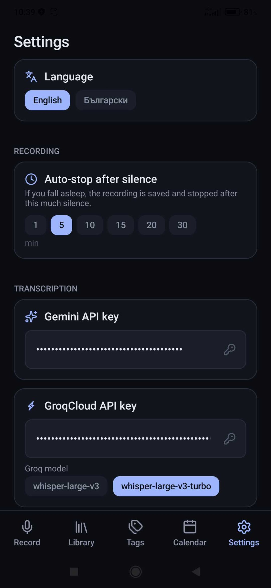
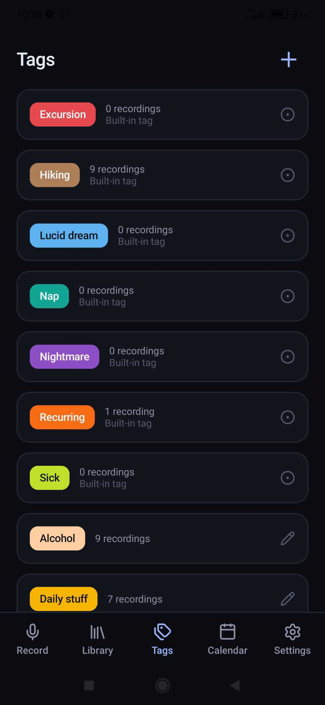
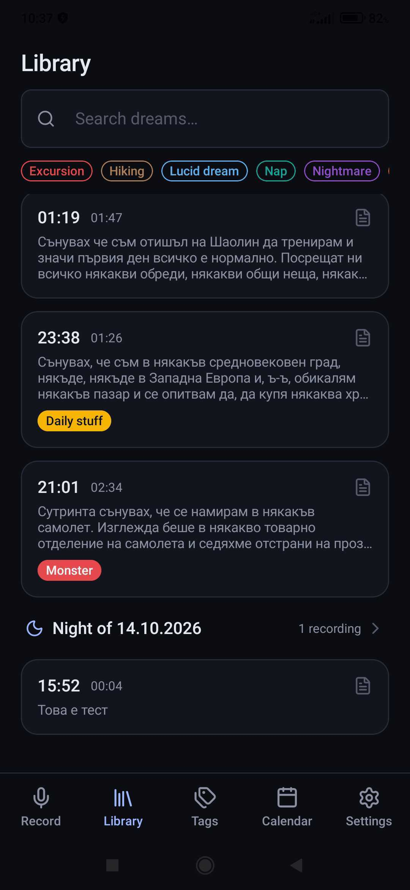

# Dream Records

<p align="center">
  <strong>Remember your dreams before they fade.</strong><br>
  A minimal, offline-first Android dream journal built for capturing thoughts in the middle of the night.
</p>

<p align="center">
  
  
  
  
</p>

Dream Records makes it easy to capture a dream as a voice note, revisit it later, and turn it into searchable text. Its low-light interface is designed for nighttime use, while recordings and journal entries are kept in private app storage unless you explicitly export them or request an online transcription.

## Screenshots

<!-- Row 1: Recording, Calendar, Settings -->
<p align="center">
  
  &nbsp;
  
  &nbsp;
  
</p>

<!-- Row 2: Tags, Recording Details, Library -->
<p align="center">
  
  &nbsp;
  
  &nbsp;
  
</p>


## Features

- **One-tap voice recording:** Start and stop recordings using a large microphone control. Recording runs in an Android foreground service and can continue with the screen off.
- **Automatic silence detection:** Save and stop a recording after 1, 5, 10, 15, 20, or 30 minutes of silence, configurable in Settings.
- **Optional AI transcription:** Transcribe recordings through Gemini, Groq Whisper, or ElevenLabs using your own API keys. Choose between Groq Whisper models in Settings.
- **Searchable dream library:** Search transcript text and filter recordings by tag. Entries are grouped into nights rather than isolated calendar dates.
- **Playback and editing:** Listen to recordings with 10-second skip controls, edit transcripts, and have changes saved automatically.
- **Personalized tags:** Create and edit colored tags, and organize entries with categories such as Lucid dream, Nightmare, and Recurring.
- **Dream calendar:** See the dates of your entries and colored markers for built-in tags. Tap a day to review its recordings.
- **Night summaries:** Combine the transcripts from a night into a single editable text while retaining the original audio files.
- **Backup and restore:** Export audio, transcripts, and tags to a ZIP archive containing YAML metadata; import ZIP or YAML files.
- **English and Bulgarian UI:** Switch the interface language directly in Settings.

## Download and installation

1. Open the repository's **Releases** section.
2. Download the APK attached to the latest release, for example `DreamRecords-release.apk`.
3. Open the APK on your Android device and follow the installation prompts. Android may ask you to allow installation from the app you used to open it.
4. Grant microphone permission when prompted. Additional permissions may be requested for background recording and notifications.

**Compatibility:** Android 10 (API 29) or newer. The application is designed for portrait orientation.

> **Release-signing notice:** The current `release` build configuration signs APKs with the Android debug certificate. This is suitable for testing but not a production distribution strategy. Before publishing long-term public releases, configure and securely retain a dedicated release signing key. An APK signed with a different key cannot directly update an existing installation; export your data before uninstalling or changing signing keys.

## Getting started

1. Open **Record** and tap the microphone to capture a voice note.
2. Tap again to finish, or let the configured silence timeout stop and save the recording.
3. Open **Library** to play the recording, read or edit a transcript, and assign tags.
4. If you want automatic transcription, configure an API key in **Settings**, open a recording, and choose a transcription provider.
5. Use **Calendar** or **Tags** to revisit related dreams.

### Optional AI transcription

Dream Records supports three external speech-to-text services:

| Provider | Model displayed in the app | Configuration |
| --- | --- | --- |
| Google Gemini | Gemini 3.5 Transcribe | Enter a Gemini API key in Settings |
| Groq | Whisper Large v3 or Whisper Large v3 Turbo | Enter a GroqCloud API key and select a model |
| ElevenLabs | Scribe v2 | Enter an ElevenLabs API key in Settings |

An internet connection and an API key for the selected provider are required. The provider may impose its own availability limits and charges. Transcription requests send the selected audio recording to that provider; read its privacy policy before using the feature. Recording, playback, and manual transcript editing do **not** require an AI service.

## How nights are organized

The journal uses an **18:00 local-time boundary**. For example, a recording made at 23:30 on October 13 and one made at 03:00 on October 14 are both organized under the night of October 14. This makes it easier to review multiple dreams from the same sleep period.

## Export and import

Navigate to **Settings → Export** to create a ZIP backup containing:

```text
dream_records_YYYY-MM-DD.zip
├── dream_records.yaml
└── audio/
    └── *.m4a
```

The YAML file stores entry metadata, transcripts, tags, and combined night texts. You can import a complete ZIP backup or a YAML file by itself. When imported entries have the same IDs as existing entries, their text, tag assignments, and combined night texts can be replaced. Importing a ZIP restores missing audio files without overwriting audio that already exists.

**Important:** Exported archives contain personal journal content and are not password-protected by the application. Store and share them carefully. Make a backup before importing edited YAML.

## Build from source

### Requirements

- **Android Studio** with the Android SDK (compile SDK 36)
- **JDK 17 or a compatible Android Studio bundled JDK**
- A device or emulator running Android 10 or later
- Internet access for the initial Gradle dependency download

Clone the repository and build a debug APK:

```bash
git clone <repository-url>
cd dream-records-android
./gradlew assembleDebug
```

On Windows, run `gradlew.bat assembleDebug` instead. On macOS/Linux, run `chmod +x gradlew` first if required by your ZIP extraction or filesystem permissions.

The resulting APK is located at:

```text
app/build/outputs/apk/debug/app-debug.apk
```

To build the current optimized, **debug-signed** release variant:

```bash
./gradlew assembleRelease
```

The release artifact is written to `app/build/outputs/apk/release/app-release.apk`. Convenience scripts are also included: `build.sh`, `run.sh`, `build.bat`, `build-debug.bat`, and `build-release.bat`. See [BUILD_WINDOWS.md](BUILD_WINDOWS.md) for Windows-specific instructions.

## Technology stack

| Layer | Technology |
| --- | --- |
| Language | Kotlin |
| UI | Jetpack Compose, Material 3 |
| Navigation | Jetpack Navigation Compose |
| Local database | Room (SQLite) |
| App preferences | Jetpack DataStore |
| Audio capture | Android MediaRecorder and foreground service |
| Networking | OkHttp |
| Data portability | YAML (SnakeYAML) and ZIP |
| Build system | Gradle with Kotlin DSL |

### Project structure

```text
app/src/main/kotlin/com/vislupus/dream_records/
├── audio/           Recording service and playback
├── config/          App settings, UI strings, tag colors
├── data/            Room database, repository, preferences
├── io/              YAML / ZIP import and export
├── transcription/   Gemini, Groq, and ElevenLabs integrations
└── ui/              Compose screens, components, navigation, theme
```

Most behavior, visual constants, model identifiers, and built-in tags can be adjusted in `config/AppConfig.kt`. User-facing strings for English and Bulgarian are located in `config/Strings.kt`.

## Privacy and permissions

See the [Privacy Policy](PRIVACY.md) for details about local storage, optional transcription, exports, and data deletion.

- Audio recordings, transcripts, and journal data are stored locally in the app's private storage by default.
- API keys are stored in app-private DataStore preferences. **They are not encrypted by a separate application-level encryption layer.** Never add real API keys to source files or bug reports.
- The app does not automatically upload your dream journal to a proprietary synchronization server.
- Audio leaves the device when you explicitly invoke an external transcription provider. Exports leave the device only when you choose to share or move them.
- Microphone access is required for recording. Internet and network-state access support optional transcription; foreground-service and notification permissions support background recording.
- Android automatic backup is disabled in the app manifest. Use the built-in export feature for backups.

## Contributing

Bug reports, suggestions, and pull requests are welcome. Please read [CONTRIBUTING.md](CONTRIBUTING.md) before contributing, and avoid including private recordings, transcripts, or API keys in issue reports.

## Acknowledgments

- [Lucide](https://lucide.dev/) icons — ISC licensed.
- Android, Kotlin, Jetpack Compose, and the open-source libraries declared in the Gradle version catalog.
- Gemini, Groq, and ElevenLabs are optional third-party transcription services and are not affiliated with this project.

## License

No project-wide open-source license has been selected yet. Repository visibility does not, by itself, grant permission to reuse the code. The project owner can add a `LICENSE` file to define reuse and contribution terms.
